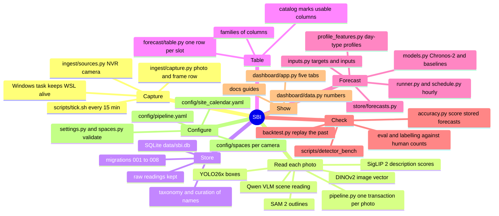

# Repo map and sweep (18 Nov 2026)

For every detail of every module, setting, table and test, see `docs/technical-deep-dive.md`.

A map of how the code fits together, what was checked in a full sweep, what was fixed, and what is still open.

An interactive graph of the whole repo (1,731 nodes, 125 groups) is in `graphify-out/graph.html`; open it in a
browser. `graphify-out/GRAPH_REPORT.md` lists the groups. That folder is not in git; rebuild it with `/graphify .`.

## Mind map



## The same thing as a flow

```
cron (every 15 min) -> scripts/tick.sh -> sbi tick                                   [tick.py]
  per space:
    capture photo from the NVR                                                       [ingest/]
    detector -> outlines -> image vector -> description scores -> VLM                [perception/, pipeline.py]
    write everything for the photo in one transaction                                [store/results.py]
    update weekday-by-hour baselines                                                 [baseline.py]
  on the hour:
    build the table                                                                  [forecast/build.py, table.py]
    choose targets and inputs, add calendar and profiles                             [forecast/inputs.py]
    Chronos-2 forecasts 4 hours                                                      [forecast/models.py]
    store the run and its values                                                     [forecast/runner.py]

dashboard (read-only) -> dashboard/data.py -> the same table and stored forecasts    [dashboard/]
sbi backtest / accuracy / eval -> reports in data/exports/                           [forecast/, eval/]
```

## Where things live

| Area | Files | Role |
|---|---|---|
| Entry points | `scripts/*.sh`, `src/sbi/cli.py`, `tick.py` | 15 commands; the scheduled run |
| Config | `config/`, `settings.py`, `spaces.py` | typed and validated; unknown keys fail loudly |
| Capture | `ingest/` | camera sources, photo capture, bad-frame check |
| Models | `perception/` | one interface per model kind, picked by `factory.py` |
| Writing results | `pipeline.py`, `store/` | one transaction per photo; numbered migrations |
| Names | `taxonomy.py`, `curation/`, `perception/normalise.py` | synonyms and groups; raw labels always kept |
| Table | `forecast/table.py`, `mask_features.py`, `embed_features.py`, `probe_features.py` | columns derived from raw readings |
| Forecasting | `forecast/inputs.py`, `profile_features.py`, `models.py`, `runner.py`, `schedule.py` | see `docs/chronos-data-flow.md` |
| Checking | `forecast/backtest.py`, `metrics.py`, `accuracy.py`, `eval/`, `labeling/`, `scripts/detector_bench/` | backtest, live accuracy, labels, detector benchmark |
| Dashboard | `dashboard/data.py`, `dashboard/app.py` | see `docs/dashboard-guide.md` |
| Tests | `tests/` (16 files, 244 tests) | fakes only: no camera, GPU or LM Studio needed |

Most connected code, from the graph: `process_frame()` (the per-photo pipeline), `SpaceConfig` (the space settings
every stage reads), `run_tick()` and the command line `main()`. The other hubs are test helpers. No import cycles.

## What was checked

| Check | Result |
|---|---|
| Test suite | 244 tests pass |
| Static check of `src/` (pyflakes) | clean |
| Every command (`migrate`, `table`, `forecast`, `backtest`, `accuracy`, `eval`, `stability`, `baseline`, `links`, `curate`, `score`, `embed`, `reprocess`) on a copy of the live database | all run; a wrong space name fails cleanly with exit code 2 |
| Database | integrity ok, no broken references, 978 photos, 0 failed captures, 0 unread, 0 VLM errors, every photo outlined |
| Scheduled runs | 478 of 478 logged runs finished "2 ok, 0 failed"; 20 to 27 s each; overlap lock, 10-minute timeout and log rotation in place |
| Secrets | none in tracked files or git history (the matches are placeholders); `.env` is ignored |
| Exposure | dashboard and labelling tool listen on this machine only |
| Restart protection | the Windows task that keeps WSL running is active |
| Disk | 651 GB free; photos grow about 190 MB a day (about 70 GB a year), the database about 9 MB a day |
| What Chronos-2 receives | regular timestamps, 0.36% missing, newest row complete, no warnings (see `docs/chronos-data-flow.md`) |

## Fixed in this sweep

1. **A photo could lose all its outlines.** When SAM 2 found nothing inside one box it returned fewer outlines than
   boxes, and the whole photo was stored without outlines (2 photos in 5 days). Now the affected batch is asked box
   by box and the empty box gets an empty outline. Real outlines are unchanged (checked on 3 live photos).
2. **README was out of date** (it still said forecasting "comes later" and that the live inputs were `calendar`).
3. **Dependencies were incomplete:** the image-vector and description models need `torch` and `transformers`, which
   were not listed. Added, with the versions known to work.
4. Removed an empty stray file (`holder`) and unused imports.

Fixed earlier the same day: the dashboard's minute refresh failing in its own thread; old forecasts being scored
against re-read photos; the dashboard not noticing re-read photos.

## Open improvements, most important first

| # | What | Why it matters | Needs |
|---|---|---|---|
| 1 | DONE 18 Nov (cached, 0.6 s): the table was rebuilt from raw readings every time | 5 s now for the cabin, about 1 s per 100 slots: half a minute at one month, over a minute at 85 days, on every hourly forecast and every dashboard refresh after a new photo | Store per-photo outline features once (the `frame_features` table exists and is empty), or cap history at the 8,192 slots Chronos-2 can read |
| 2 | Forecasts do not know weekdays | Monday after a weekend is forecast as empty | Weeks of history; then fine-tune Chronos-2 on this site (about a month of data) |
| 3 | One chair in five photos is still missed | Hidden behind a person or bag | A detector trained on these two camera views; needs boxes drawn on a few hundred photos |
| 4 | Photos and database exist only on this PC | A disk failure loses everything | A copy to another machine or drive; your decision where |
| 5 | DONE 18 Nov (user service): the dashboard was not a service | It stops when WSL restarts and must be started by hand | A systemd user service; needs your approval because it is a persistent job |
| 6 | Live accuracy reads every stored forecast | About 87,000 forecast rows are added per day; the accuracy tab will slow down over months | Score only the last 30 days by default |
| 7 | Some forecast series repeat others | `count.yolo.person` is the same as `scene.people_yolo` | Trim `forecast_targets` in the space files |
| 8 | Holiday list has 3 dates | The working-day flag is wrong on office holidays | Paste the office list into `config/site_calendar.yaml` |
| 9 | One VLM host | If LM Studio is down, VLM columns are empty for those slots (shown amber on the dashboard) | Nothing urgent; a second host or local fallback later |
| 10 | Parking motorcycles are undercounted | Average miss about 3 of 8 | Left loose by decision; the same camera-specific detector as item 3 would help |
| 11 | Licence | Ultralytics (YOLO26, SAM 2 wrapper) is AGPL-3.0 and this repo is public | Only matters if this is distributed or sold |

## Graph caveats

The graph tool reported 488 edges that point to names outside the repo (library symbols) and 3 self-loops. They do
not affect the map above. README.md changed while it was being read, so the next `/graphify . --update` re-reads it.
